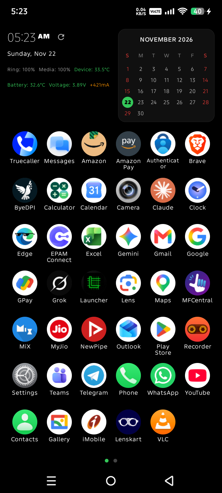
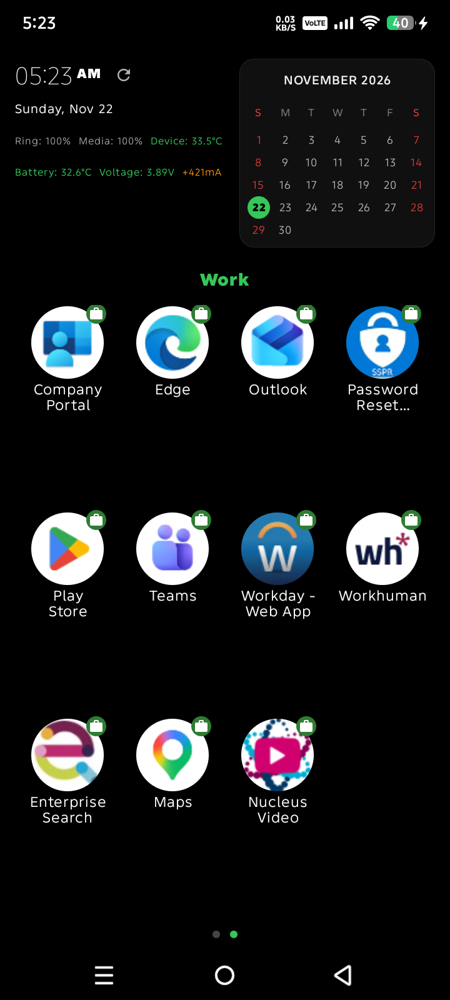

<p align="center">
  
</p>

<h1 align="center">Kuro (黒)</h1>

<p align="center">
  
  
</p>

A single-screen, zero-scroll, pitch-black Android launcher engineered for pure speed, zero background battery waste, and distraction-free daily use.

---

## Compatibility

- **Minimum Android version:** Android 7.0 (Nougat, API 24)
- **Target Android version:** Android 15 / 16 (API 37)
- Works on any Android phone, tablet, or foldable running Android 7.0 through Android 15+.

---

## Where this came from

The idea hit me while waiting at a bus stop early in the morning for my ride. 

I was tired of hopping between LineageOS Launcher, Microsoft Launcher, and other home screens just trying to get decent battery life out of my phone. On top of the battery drain, I kept thinking about the background telemetry and data collection crawling through typical launchers. I built Kuro in my free time to solve this exact problem: an honest, pitch-black, zero-bloat home screen that does not get in your way.

---

## Key Features

### 1. Single-Screen Zero-Scroll Grid
Every app you have fits on a single screen. Kuro calculates your display dimensions and proportions icons, font sizes, and row spacing so you never have to scroll down an app drawer again. Everything is one tap away.

### 2. Built-in Work Profile Support
Work apps stay completely isolated on their own dedicated page. Swipe right to access work apps with custom green badges positioned on the icon corner, keeping work tools organized without cluttering your personal home screen.

### 3. Compact Multi-Month Calendar
Glance at a 1- or 2-month calendar right next to the clock. Weekends are highlighted in red, the current day is marked in green, and dates update automatically at midnight.

### 4. Real-Time Hardware HUD
Optional live diagnostics at the top of your screen:
- Live charging/drain current (+mA / -mA)
- Battery pack voltage (V)
- Ring and Media volume percentages
- Device and battery temperatures

### 5. True AMOLED Black (#000000)
Pure black pixels are powered off on OLED displays, using 0% backlight power.

### 6. Zero Background Battery Drain
Kuro unregisters all listeners when you are inside an app or when your screen is locked. It runs zero polling loops and wakes up only when Android fires a system broadcast.

---

## Technical Highlights

- Built 100% with native Jetpack Compose.
- Single APK footprint of ~1.5 MB with R8 full-mode optimization.
- Zero external ad SDKs, trackers, or network calls.

---

## Installation

1. Download `Kuro-v1.9.2.apk` from the [Releases](https://github.com/arjncx-lang/kuro/releases) tab.
2. Install with adb or your device file manager:
   ```bash
   adb install -r Kuro-v1.9.2.apk
   ```
3. Set Kuro as your default home app.
